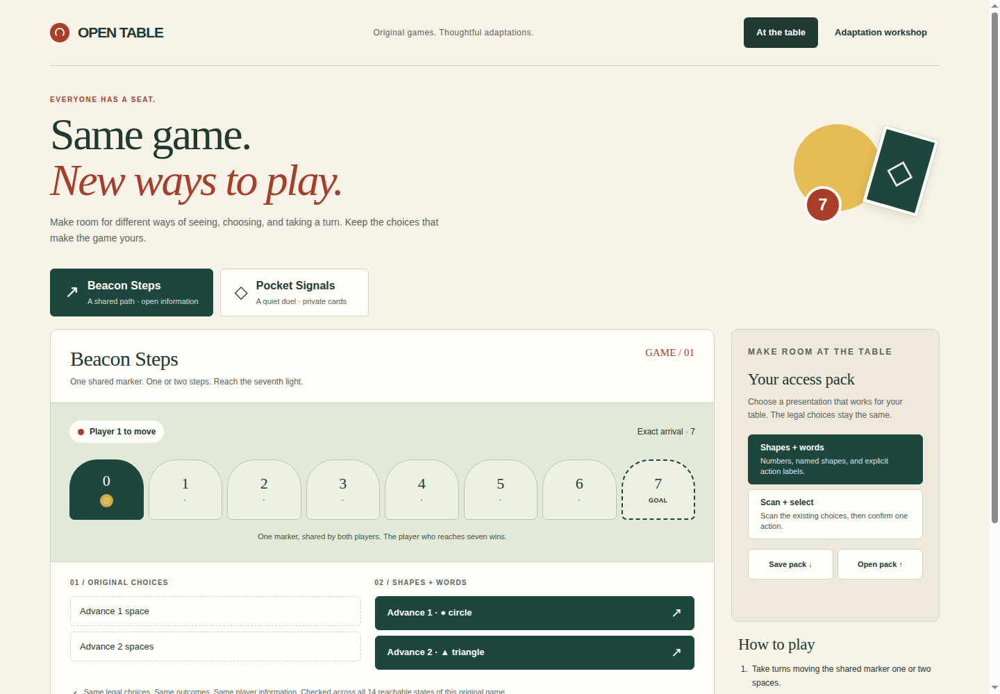

# OPEN TABLE

**Same game. New ways to play.** A private, working prototype for designers and mixed-access play groups: try two original games, choose a presentation, inspect exactly what it preserves, and save a reusable access pack.

This is selected concept 14 in [the estate product workstream](https://github.com/Jacob-Met/hamon/issues/1631#issuecomment-6431153046). It is an original implementation of OPEN TABLE. The earlier TRACEWALK candidate is stopped and checkpointed separately.



## Run

Node.js 22 or later is required. The application has no third-party runtime dependencies and makes no external network requests.

```sh
npm start
```

Open the printed loopback URL, normally `http://127.0.0.1:4287/`. Set `PORT=0` to choose an available port. The server binds only to 127.0.0.1.

The normal start, test, and package commands verify the generated source pins. After deliberately editing the game, adapter, renderer, pack boundary, fixture definitions, or authored catalog, regenerate the pins with `npm run pins`, review the changed binding, and rerun the affected receiving course.

## At the table

**Beacon Steps** is a public-information race. Two players alternate moving one shared marker by one or two spaces. Exact arrival at seven wins; overshooting is illegal. The complete state space contains 14 reachable states and 22 legal transitions.

**Pocket Signals** is a two-round private-card game. Deal each player two different values from 1–5 without replacement; leave one card out. Player 1 commits privately, then Player 2 commits. Reveal both cards together and award one point to the higher card. Repeat with the remaining cards. A final one–one score is a draw. All 30 initial deals together reach 450 states and 420 legal transitions.

The rules use public labels Player 1 and Player 2; engine observer IDs are 0 and 1 respectively.

Choose **Shapes + words** for explicit numbered, named-shape controls, or **Scan + select** for manual cycling or timed scanning followed by explicit confirmation. Scanning alone does not make a move. Automatic scan intervals are 1.4, 2.4, or 4 seconds. This qualifies the action-selection mechanism after setup; whole-application single-switch navigation and physical switch hardware have not been evaluated.

Both original and adapted choices appear for the same acting player. Pocket Signals clears private cards and both choice panels before handing the device over. A repeated held Enter cannot activate the next player's reveal control; a fresh press still works.

This is cooperative **local pass-and-play on a trusted device**. It is not secure remote multiplayer. Full game truth exists in the local application memory; anyone controlling the device or developer tools can inspect it. Players should look away for the other person's private turn.

## The workshop

The independent checker enumerates every reachable state of each original game. It compares legal-action bijections, successor states, outcomes, and both directions of each player's information partition. Action labels are part of the observed information, so a label that gives away a hidden card fails. Authored candidate functions receive detached inputs and outputs, protecting the reference state and retained witnesses from mutation.

Two intentionally bad designer controls illustrate failure:

- Removing a legal choice is rejected with a concrete action mismatch.
- Revealing the opponent's hand is rejected with two synthetic worlds that look identical in the original game and different in the adaptation.

These examples are separate from the live game. Negative controls cannot activate as access packs. The no-hidden-information Beacon game is not falsely rejected merely because a control is named “reveal opponent.”

A finite equivalence result establishes preservation for these games and fixed adapters. It does not establish universal accessibility, enjoyment, usability with a screen reader or physical switch, or equivalence for arbitrary tabletop games. Human access playtests remain necessary.

## Save and reopen

**Save pack** downloads a small JSON selection containing only its schema, game, source pin, candidate classification, and safe adapter. It contains no hands, pending values, live deal identifier, play history, raw state key, or imported proof.

**Open pack** validates the selection, rejects unknown fields, stale pins, variants, and negative controls, and runs the independent checker again before activation. A pack is an adaptation selection, not a saved game or portable certificate.

The SHA-256 binding includes the authored catalog and exact current engine, adapter/checker, renderer, pack implementation, and synthetic fixture source. It is reproducible and has no generated timestamp or randomness. A startup/package gate rejects stale generated pins.

## Grounded proposal authoring

The workshop can review a constrained proposal against approved rule phrases and component references. It renders suggested text as text, rejects permission/rule/certification overrides, invalidates an old review when input changes, and requires explicit author review before checking a supported mode. A `variant` stays an unapproved idea and cannot enter the preserving-pack activation path.

The example is authored test data. **No NVIDIA/Nebius inference has run in this prototype.** The offline experiment prepares four development access goals and two reserved mixed-goal cases from static authored context. It compares a declared deterministic selector with a future actual model response; validity and finite equivalence are kept separate from rationale truth and usefulness.

```sh
node scripts/model-development.mjs
```

This command makes zero provider requests and does not run the reserved cases. Existing authorized account access, a current NVIDIA model on Nebius, and an actual bounded invocation remain dependencies. No keys, model weights, cloud resources, public release, or competition submission are included.

## Verification

```sh
npm test
node scripts/browser-receive.mjs
npm pack
```

The browser course uses the installed Chrome at `/usr/local/bin/google-chrome` and Node's built-in CDP transport. It starts its own loopback server and browser profile, blocks non-loopback page traffic, and closes only the process it launched. Set `OPEN_TABLE_RECEIVING_URL` to receive an already-running copy, or `OPEN_TABLE_RECEIVING_DIR` to retain a separate run. The scripts do not inspect signed-in browser profiles.

The qualified source passed 42 native/HTTP tests and 15 actual-browser scenarios on Node 22.23.4 / Chrome 156.0.8078.47. Browser evidence covers complete game outcomes, scan/confirm behavior, private handoffs and a repeated-key regression, indistinguishable private states, actual downloads/file-input reopening, rejected imports, proposal boundaries, designer separation, and 1440/390/320-pixel layouts. Desktop and narrow screenshots were visually reviewed.

See [receiving evidence](docs/RECEIVING.md), [research and model-route limits](docs/RESEARCH.md), and [recovery state](docs/RECOVERY.json). The separate clean archive also passed all 42 native/HTTP and 15 browser scenarios through its own npm start. Private remote source/tree identity was verified. The [qualified private archive](release-artifacts/open-table-0.1.0-af04f2b.tgz) is retained for review.

## Ownership

Private estate source. All game rules, UI, synthetic fixtures, and visual artwork here are original authored material. No third-party game art, commercial rulebook, audio sample, or model weights are bundled. No public license or release is granted by this prototype.
